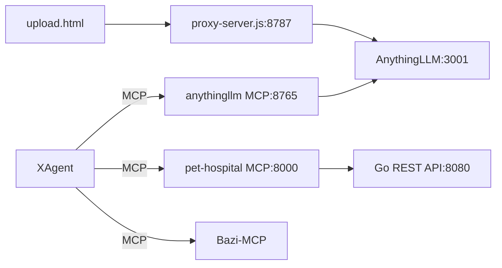

# LUM —— MCP 服务、AnythingLLM 集成与定制 Agent

本仓库是课程项目的统一代码库，包含 1 个业务 MCP Server、1 个 AnythingLLM MCP Server、
1 个浏览器上传页 + 本地代理，以及 1 个具备工具/技能/MCP/长期记忆的终端 Agent。

## 项目地图

```
LUM/
├── .mcp.json                  # MCP 客户端配置（Bazi-MCP / anythingllm / pet-hospital）
├── .agents/skills/            # 可复用技能（含 validate_skills.py 校验脚本）
├── PetHospitauMCP/            # A. 宠物医院 MCP：Go REST 后端 + Python MCP Server
├── AnythingLLMMCP/            # B. AnythingLLM MCP：工作区/对话/文档上传向量化
├── AnythingLLMServer/         # C. 文档上传网页 + 本地反向代理（隐藏 API Key）
└── agent/
    ├── XAgent/                # D. 定制 Agent（工具调用 / 技能 / MCP / 会话 / 压缩）
    ├── Plractice01/           # 课堂练习：基础 Function Calling（目录名为课程原始命名）
    └── Practice02/            # 课堂练习：文件工具 + 时间/闰年工具
```

模块关系：



## 环境依赖

| 组件 | 版本 |
|---|---|
| Python | 3.10+（推荐 3.13） |
| Go | 1.22+（仅 A 的后端） |
| Node.js | 18+（仅 C） |
| AnythingLLM | 本机运行，默认 `http://localhost:3001` |

## 一键启动顺序（推荐）

```text
1. AnythingLLM        → 启动桌面端，生成 API Key
2. PetHospitauMCP     → 先启动 Go 后端(8080)，再启动 Python MCP(8000)
3. AnythingLLMMCP     → python server.py (8765)
4. AnythingLLMServer  → node proxy-server.js (8787)，浏览器打开 /upload.html
5. agent/XAgent       → python main.py
```

### A. 宠物医院 MCP

```bash
cd PetHospitauMCP
go run .                                  # REST 后端 :8080
cd pet_hospital_mcp
pip install -e ".[dev]"
python -m pet_hospital_mcp                 # MCP :8000（streamable-http）
```

详见 [pet_hospital_mcp/README.md](PetHospitauMCP/pet_hospital_mcp/README.md)，包含 Inspector 连接与 HTTP 调用示例。

### B. AnythingLLM MCP

```bash
cd AnythingLLMMCP
pip install -r requirements.txt
copy .env.example .env                    # 填 ANYTHINGLLM_API_KEY
python server.py                          # MCP :8765
```

详见 [AnythingLLMMCP/README.md](AnythingLLMMCP/README.md)。

### C. 上传网页 + 代理

```bash
cd AnythingLLMServer
npm install
copy .env.example .env                    # 填 ANYTHINGLLM_API_KEY
node proxy-server.js                      # 打开 http://localhost:8787/upload.html
```

详见 [AnythingLLMServer/README.md](AnythingLLMServer/README.md)。

### D. XAgent

```bash
cd agent/XAgent
pip install -r requirements.txt
copy .env.example .env                    # 填 API_KEY / BASE_URL / MODEL
python main.py
```

详见 [XAgent/README.md](agent/XAgent/README.md)。

## 配置与密钥

| 文件 | 用途 | 是否入库 |
|---|---|---|
| `agent/XAgent/.env` | LLM Key / Base URL / 模型 | 否（`.gitignore`） |
| `agent/XAgent/config.ini` | 窗口、沙箱、步数、超时、追踪 | 否（`.gitignore`） |
| `AnythingLLMMCP/.env` | AnythingLLM 地址与 Key | 否 |
| `AnythingLLMServer/.env` | 代理端口与 AnythingLLM Key | 否 |
| `.mcp.json` | MCP Server 列表（不含密钥） | 是 |

- 真实密钥只放在本机 `.env`，仓库只保留 `.env.example`；
- 前端页面不持有任何 Key，全部由本地代理附加；
- 文件工具限制在 `agent/XAgent` 沙箱内，删除操作需 `confirm=true`。

## 验证方式

```bash
# A：单元测试（53 个）
cd PetHospitauMCP/pet_hospital_mcp && pytest -q

# D：本地工具单元测试
cd agent/XAgent && python -m unittest discover -s tests -v

# 技能结构校验
python .agents/skills/validate_skills.py

# 语法检查
python -m py_compile agent/XAgent/main.py AnythingLLMMCP/server.py
node --check AnythingLLMServer/proxy-server.js
```

## 目录约定

- 每个子项目只依赖自己的 `requirements.txt` / `pyproject.toml` / `package.json`；
- 运行产物（`__pycache__`、`build/`、`dist/`、`node_modules/`、`*.exe`、数据库文件）均不入库；
- 课程练习代码单独放在 `agent/Practice*/`，不与最终 Agent 混放。
