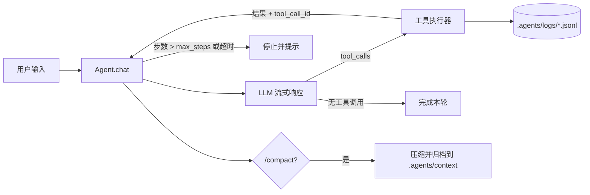

# XAgent —— 具备工具调用、技能、MCP 与长期记忆的终端 Agent

XAgent 是一个可交互（Textual TUI）也可单轮（`--prompt`）运行的本地 Agent。它基于 OpenAI 兼容的
Function Calling 协议，自行实现多轮工具闭环、上下文压缩、会话持久化、技能（Skill）加载、
AGENTS.md 规则注入与 MCP Server 接入。

## 快速开始

```bash
cd agent/XAgent
python -m venv .venv
.venv\Scripts\activate           # macOS/Linux: source .venv/bin/activate
pip install -r requirements.txt

copy .env.example .env           # 填入 API_KEY / BASE_URL / MODEL
python main.py                   # 交互式 TUI
python main.py --prompt "现在几点？顺便判断 2024 是不是闰年"   # 单轮
```

首次启动会在 `agent/XAgent/config.ini` 生成配置模板（已被 `.gitignore` 忽略），按需修改后重启。

### 环境变量（`.env`）

| 变量 | 必填 | 说明 |
|---|---|---|
| `API_KEY` | 是 | OpenAI 兼容服务的 Key |
| `BASE_URL` | 否 | 默认 `https://api.deepseek.com` |
| `MODEL` | 否 | 默认 `deepseek-chat` |

## 目录结构

```
agent/XAgent/
├── main.py                    # 入口：TUI 或 --prompt 单轮
├── requirements.txt
├── .env.example
├── core/
│   ├── agent.py               # 主循环：流式解析、工具执行、步数/超时保护
│   ├── skill_loader.py        # 技能发现与元数据注入
│   ├── context_manager.py     # 上下文压缩、历史归档、检索
│   ├── session_store.py       # 会话 JSONL 持久化与列表/恢复
│   ├── slash_commands.py      # 斜杠命令注册与实现
│   ├── agents_md.py           # AGENTS.md 查找、截断与一次性注入
│   └── trace.py               # JSONL 结构化调用追踪
├── tools/
│   ├── __init__.py            # 工具注册表（18 个本地工具 + MCP 动态工具）
│   ├── file_ops.py            # 10 类文件/目录工具（沙箱内）
│   ├── time_ops.py            # getCurrentTime / isLeapYear
│   ├── web_search.py          # searchWeb（百度千帆 API）
│   ├── fetch_web.py           # fetchWeb（curl + trafilatura 正文提取）
│   ├── cli_ops.py             # runCli（subprocess，shell=False）
│   ├── skill_ops.py           # createSkill / loadSkill
│   ├── context_ops.py         # recallContext 历史检索
│   └── mcp_client.py          # MCP 连接、工具发现、跨线程调用
├── config/
│   └── config_manager.py      # 统一配置（.env + config.ini + 默认值）
├── ui/
│   └── tui.py                 # Textual 终端界面
└── tests/
    └── test_local_tools.py    # 本地工具单元测试（stdlib unittest）
```

## 工具清单（18 个本地工具）

| 类别 | 工具 | 说明 |
|---|---|---|
| 文件（10） | `get_cwd` / `list_dir` / `get_file_type` | 工作目录、目录列表、路径类型 |
| | `read_file` / `create_file` / `edit_file` | 读取；创建；overwrite/append/replace |
| | `create_dir` / `delete_dir` / `delete_file` / `rename_path` | 目录与文件管理（删除需 `confirm=true`） |
| 时间（2） | `getCurrentTime` | 支持 local / UTC / IANA 时区，返回真实系统时间 |
| | `isLeapYear` | 公历闰年规则（整百年需被 400 整除） |
| 联网（2） | `searchWeb` | 百度千帆 `web_search`，返回标题+摘要+URL |
| | `fetchWeb` | 下载网页并提取正文为 Markdown |
| 终端（1） | `runCli` | 执行本机 CLI（`subprocess.run`，`shell=False`） |
| 技能（2） | `createSkill` / `loadSkill` | 技能落盘（目录 + SKILL.md）与按需加载 |
| 记忆（1） | `recallContext` | 检索被压缩归档的历史对话 |

此外，`.mcp.json` 中配置的 MCP Server 工具会以 `{server}_{tool}` 前缀动态并入同一工具表。

## 工作循环



- 工具异常不会中断对话：错误文本写回 `tool` 消息，模型可自行修正后重试。
- `max_steps`（默认 20）与 `turn_timeout`（默认 300s）超限时停止本轮并在界面提示。

## 技能（Skill）

技能是“目录 + `SKILL.md`（YAML frontmatter + 正文）”的可复用流程：

```
.agents/skills/
├── notice/SKILL.md
├── mini-encryption/SKILL.md
└── officeCLI/SKILL.md
```

- 启动时只扫描 `name` / `description` 注入 system prompt（不占大量上下文）；
- 需要时由模型调用 `loadSkill` 读取正文，读取内容超过 `skill_max_chars` 会截断；
- `createSkill` 会校验命名、拒绝覆盖已存在技能；
- 提交前可运行结构校验：

```bash
python ../../.agents/skills/validate_skills.py
```

## AGENTS.md（项目规则）

- 启动/恢复会话时向上查找 `AGENTS.md` 或 `AGENT.md`（最多 10 层），找到后**只注入一次**；
- 超过 `agents_md_max_chars`（默认 12000）自动截断并标注；
- 文件不存在或读取失败时静默跳过，不影响启动；
- 可通过 `config.ini` 的 `[agent] load_agents_md = false` 关闭。

## MCP 接入

项目根 `.mcp.json` 可配置多个 MCP Server（stdio / sse / streamable_http）：

```json
{
  "mcpServers": {
    "Bazi-MCP": { "transport": "streamable_http", "url": "https://.../mcp", "timeout": 10 },
    "anythingllm": { "transport": "streamable_http", "url": "http://127.0.0.1:8765/mcp" },
    "pet-hospital": { "transport": "streamable_http", "url": "http://127.0.0.1:8000/mcp" }
  }
}
```

- 所有 Server 并行连接，共享 `[mcp] timeout` 超时窗口；
- 工具名加 Server 前缀，重名不冲突，来源可追溯；
- 单个 Server 失败只打印告警，其余工具照常可用；
- `/mcp` 查看连接状态。

> 使用 `anythingllm` / `pet-hospital` 前需先按对应 README 启动这两个 MCP Server；未启动时会被跳过。

## 会话、压缩与追踪

- **会话**：`/save` 手动保存到 `.agents/sessions/<id>.jsonl`；`/new`、`/clear` 会先自动保存当前会话；
  `/list` `/resume` `/delete` 管理历史会话；
- **压缩**：通过 `/compact` 触发压缩，原文归档到 `.agents/context/`，可用 `recallContext` 检索；
- **追踪**：工具调用/结果/错误/轮次结束写入 `.agents/logs/YYYYMMDD.jsonl`，字段包含
  `ts / event / tool / args / status / duration_ms / result_preview`。

## 斜杠命令

`/help` `/new` `/save` `/list` `/resume` `/delete` `/compact` `/clear` `/context`
`/model` `/system` `/skills` `/mcp` `/refresh` `/quit`

## 配置项（`config.ini`）

| Section | 键 | 默认 | 说明 |
|---|---|---|---|
| `[llm]` | `window_size` | 131072 | 上下文窗口 token 上限 |
| | `compact_temperature` | 0.1 | 压缩调用温度 |
| `[agent]` | `sandbox_root` | 空 | 文件沙箱根，空=XAgent 目录 |
| | `load_agents_md` | true | 是否注入 AGENTS.md |
| | `agents_md_max_chars` | 12000 | 规则文件截断长度 |
| | `skill_max_chars` | 20000 | 技能正文截断长度 |
| | `max_steps` | 20 | 单轮最大步数 |
| | `turn_timeout` | 300 | 单轮超时（秒） |
| | `trace_enabled` / `trace_dir` | true / `.agents/logs` | 调用追踪 |
| `[mcp]` | `timeout` | 10 | MCP 连接超时（并行共享） |
| `[search]` | `baidu_qianfan_api_key` | 空 | 千帆搜索 Key，空则 searchWeb 返回未配置 |
| `[tui]` | `sidebar_width` / `theme` | 30 / auto | 界面外观 |

## 单元测试

```bash
cd agent/XAgent
python -m unittest discover -s tests -v
```

覆盖：时间/闰年规则、文件创建/读取/追加/重命名、删除确认、路径越界拦截、
AGENTS.md 只注入一次与超长截断。

## 安全边界

- 文件工具只允许操作 `sandbox_root` 内路径，越界直接抛错；
- `delete_file` / `delete_dir` 必须显式 `confirm=true`，否则拒绝；
- `runCli` 使用 `subprocess.run(shell=False)` + 超时；
- MCP/搜索等外部失败降级为可读错误，不暴露堆栈；
- 真实 API Key 只从 `.env` 读取，`.env`/`config.ini` 均已加入 `.gitignore`。

## 常见问题

| 现象 | 原因 | 处理 |
|---|---|---|
| `ModuleNotFoundError: yaml` | 依赖未装全 | `pip install -r requirements.txt` |
| `未配置搜索 API Key` | `[search]` 为空 | 填入千帆 Key 或改用 `fetchWeb` |
| MCP 工具不出现 | Server 未启动/地址错 | 查看 `/mcp` 输出与 `.mcp.json` |
| 回复被截断 | 达到 `max_steps`/`turn_timeout` | 调大配置或缩小任务粒度 |
| 读不到 AGENTS.md | 文件在更上层或未命名 | 放在 XAgent 目录或其父目录，命名为 `AGENTS.md` / `AGENT.md` |
